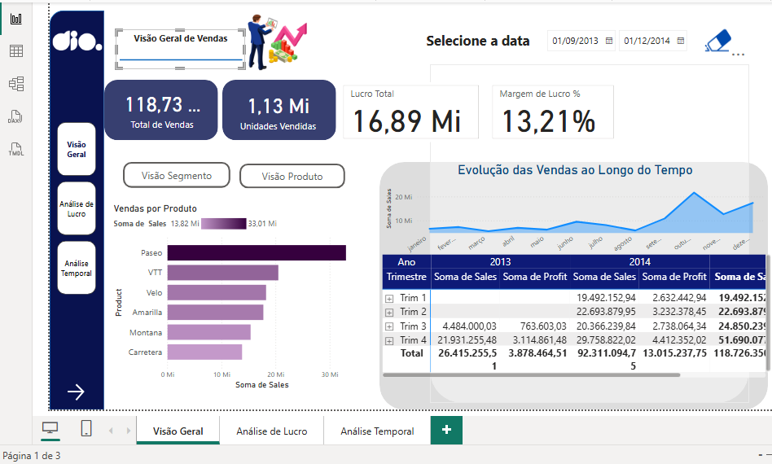
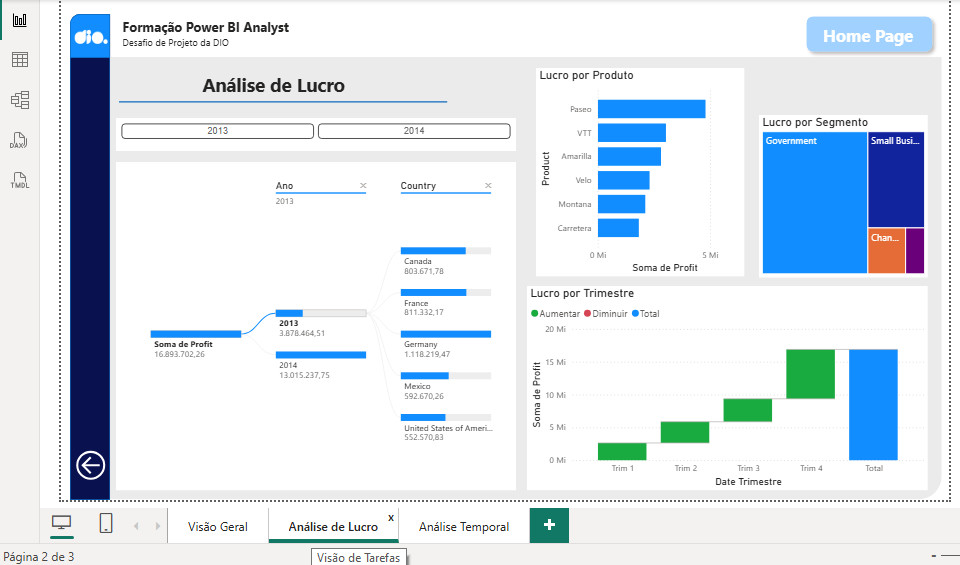
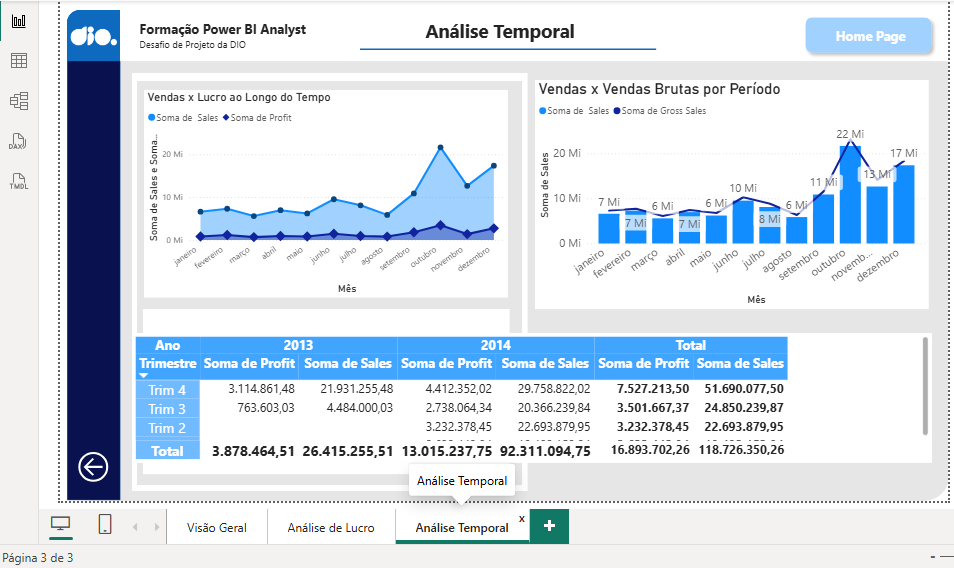

# Projeto de Data Analytics com Power BI

Projeto desenvolvido no desafio da formação **Power BI Analyst da DIO**, com foco na evolução de um relatório existente por meio de melhorias visuais, organização das informações e análises orientadas a Data Analytics.

## Autora

**Viviane Rambor**

## Objetivo

O objetivo do projeto foi aprimorar um dashboard financeiro existente no Power BI, tornando a leitura dos dados mais clara e estruturada, com destaque para indicadores de vendas, lucro, margem, produtos, segmentos e evolução temporal.

## Ferramenta utilizada

- Microsoft Power BI Desktop

## Estrutura do dashboard

O relatório final foi organizado em três páginas principais:

### 1. Visão Geral de Vendas

Página destinada à apresentação dos principais indicadores e análises gerais do desempenho comercial.

Principais elementos:

- Total de Vendas;
- Unidades Vendidas;
- Lucro Total;
- Margem de Lucro;
- Vendas por Segmento;
- Vendas por Produto;
- Evolução das Vendas ao Longo do Tempo;
- matriz com Sales e Profit;
- filtros por período;
- navegação entre diferentes perspectivas de análise.



### 2. Análise de Lucro

Página dedicada ao detalhamento da lucratividade e à identificação dos fatores que influenciam o resultado.

Principais elementos:

- árvore de decomposição do lucro;
- Lucro por Produto;
- Lucro por Segmento;
- Lucro por Trimestre;
- filtros por período;
- análise por país.

O gráfico radar existente no relatório original foi substituído por um gráfico de barras horizontais, facilitando a comparação do lucro entre os diferentes produtos.



### 3. Análise Temporal

Página voltada para a análise da evolução dos resultados ao longo do tempo.

Principais elementos:

- Vendas x Lucro ao Longo do Tempo;
- Vendas x Vendas Brutas por Período;
- análise mensal;
- matriz de Sales e Profit;
- comparação entre 2013 e 2014;
- detalhamento por trimestre.



## Medidas criadas

### Lucro Total

```DAX
Lucro Total =
SUM(financials[Profit])
```

### Margem de Lucro

```DAX
Margem de Lucro % =
DIVIDE(
    SUM(financials[Profit]),
    SUM(financials[Sales]),
    0
)
```

## Melhorias realizadas

- reorganização das páginas do relatório;
- criação dos indicadores de Lucro Total e Margem de Lucro;
- melhoria das matrizes de análise;
- padronização dos títulos;
- reorganização dos elementos visuais;
- substituição do gráfico radar por barras horizontais;
- melhoria das análises temporais;
- inclusão de Sales e Profit nas matrizes;
- criação de análise comparativa entre vendas e lucro;
- manutenção e aprimoramento da navegação;
- melhoria da hierarquia visual das informações.

## Estrutura do repositório

```text
power-bi-data-analytics-dio/
│
├── README.md
├── dashboard/
│   └── Relatorio_Data_Analytics_PowerBI.pbix
│
└── images/
    ├── visao-geral.png
    ├── analise-de-lucro.png
    └── analise-temporal.png
```

## Resultado

O dashboard final permite analisar de forma integrada:

- desempenho geral das vendas;
- unidades vendidas;
- lucro total;
- margem de lucro;
- desempenho por produto;
- desempenho por segmento;
- comportamento do lucro;
- evolução mensal dos resultados;
- comparação entre períodos.

## Considerações finais

O projeto possibilitou aplicar conceitos de **Power BI, Data Analytics e visualização de dados**, aprimorando um relatório existente e tornando as análises mais claras, organizadas e orientadas à tomada de decisão.
